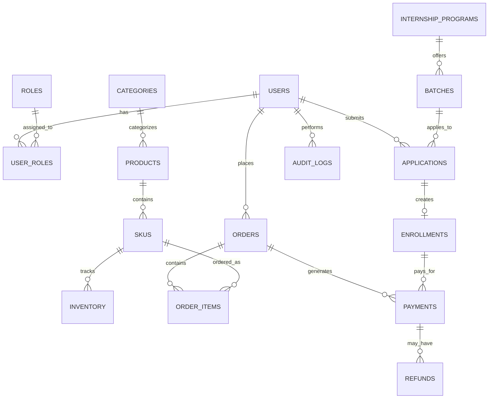

# SMPS Tech Lab - Master Architecture & Technical Design (Phase 1)

## 1. Executive Summary & Core Tech Stack
This architecture document specifies the technical design, system boundaries, database schemas, security controls, and deployment strategy for the SMPS Tech Lab platform.

### Approved Technology Stack
* **Frontend Application (`apps/web`)**:
  * **Framework**: Next.js 15+ (App Router, Server Components by default, Client Components strictly for interactive elements).
  * **Language & Types**: TypeScript in strict mode (`"strict": true`, `"noImplicitAny": true`).
  * **Styling**: Tailwind CSS with a restrained, premium engineering palette (dark slate, crisp neutral borders, deep tech blue, safety orange accent, high contrast WCAG 2.2 AA compliant typography). No purple gradients, no pill buttons.
  * **UI Primitives**: Radix UI / shadcn/ui primitives.
  * **Icons**: Lucide React.
  * **State & Forms**: React Hook Form with Zod validation; TanStack Query for server-state caching and synchronization.
* **Backend Application (`apps/api`)**:
  * **Framework**: Python 3.14+ / FastAPI (high-throughput async REST API under `/api/v1/`).
  * **ORM & Database Tooling**: SQLAlchemy 2.0 (asyncio with `asyncpg`) and Alembic for versioned schema migrations.
  * **Validation & DTOs**: Pydantic v2 for authoritative request parsing and strict response schemas.
  * **Security & Auth**: Supabase JWT verification with cryptographic signature validation; server-side Role-Based Access Control (RBAC).
* **Authoritative Database & Identity**:
  * **Database**: PostgreSQL (hosted on Supabase) with ACID transactions, foreign key constraints, composite indexes, and decimal precision for currency.
  * **Identity Store**: Supabase Auth (owning user credentials and OAuth, verified via FastAPI middleware).
* **Payment Processing**:
  * **Provider**: Razorpay API with server-side HMAC-SHA256 webhook signature verification and idempotent order state transitions.

---

## 2. System Boundaries & Modular Monolith Layout

```
                  +----------------------------------------------+
                  |                 Client Web                   |
                  |  (Next.js App Router - Public, Student, Ops)  |
                  +----------------------+-----------------------+
                                         |
                       HTTPS + Strict CORS + JWT
                                         |
                                         v
                  +----------------------------------------------+
                  |               FastAPI Gateway                |
                  |  - Rate Limiter (SlowAPI)                    |
                  |  - Request Correlation ID Middleware         |
                  |  - Supabase JWT Verification & RBAC Guard    |
                  |  - Standardized JSON Error Handler           |
                  +----------------------+-----------------------+
                                         |
          +------------------------------+------------------------------+
          |                              |                              |
          v                              v                              v
+-------------------+          +-------------------+          +-------------------+
|  Internships Hub  |          |   Commerce Hub    |          |   Security & Admin|
| - Program Catalog |          | - Hardware Catalog|          | - Role Assignment |
| - Applications    |          | - Stock Locking   |          | - Audit Logging   |
| - Batches & Cap   |          | - Order FSM       |          | - Refund Engine   |
| - Student Records |          | - Payment Webhook |          | - Analytics DTOs  |
+---------+---------+          +---------+---------+          +---------+---------+
          |                              |                              |
          +------------------------------+------------------------------+
                                         |
                             SQLAlchemy 2.0 (Async)
                                         |
                                         v
                  +----------------------------------------------+
                  |         PostgreSQL Database (Supabase)       |
                  | - Strict Foreign Keys & Indexes              |
                  | - Row-Level Checks & Constraints             |
                  | - Immutable Audit Log Table                  |
                  +----------------------------------------------+
```

### Trust Boundary Rules
1. **Frontend (`apps/web`) is Untrusted**:
   * The browser never calculates item prices, discount totals, enrollment fees, or stock levels.
   * The browser never initiates status transitions (e.g. `PAYMENT_PENDING -> PAID`) without cryptographic backend verification.
   * `apps/web` contains only public environment variables (`NEXT_PUBLIC_SUPABASE_URL`, `NEXT_PUBLIC_SUPABASE_ANON_KEY`, `NEXT_PUBLIC_RAZORPAY_KEY_ID`).
2. **Backend (`apps/api`) is Authoritative**:
   * Holds `SUPABASE_SERVICE_ROLE_KEY`, `SUPABASE_JWT_SECRET`, and `RAZORPAY_KEY_SECRET`.
   * Enforces all RBAC permissions, stock reservation locks, and payment reconciliation.
3. **Internal Network / DB**:
   * Database credentials are never stored in source code.
   * Direct SQL queries from clients are forbidden; all state changes traverse domain services.

---

## 3. Authentication & Role-Based Access Control (RBAC)

### User Roles
1. `visitor`: Unauthenticated public guest. Can view public catalog, company info, verified achievements.
2. `student`: Enrolled or prospective student. Can view own applications, batches, course materials, receipts.
3. `customer`: Hardware store buyer. Can view own orders, invoices, tracking status.
4. `operations_staff`: Controlled internal team. Can inspect applications, orders, update tracking, manage inventory.
5. `admin`: Business administrator. Can manage programs, set pricing, view revenue analytics, issue approved refunds, manage staff.
6. `super_admin`: System owner. Role management, audit trail inspection, system configuration.

### Authentication Flow
1. User logs in via Supabase Auth on the frontend (`apps/web`).
2. Supabase returns an `access_token` (JWT signed with ES256/HS256).
3. The frontend sends this token in the `Authorization: Bearer <token>` header to FastAPI.
4. FastAPI `auth_middleware`:
   * Validates token signature against `SUPABASE_JWT_SECRET`.
   * Checks expiration (`exp`), audience (`aud`), and issuer (`iss`).
   * Extracts `sub` (User UUID) and resolves the user's role from the local `user_roles` table in PostgreSQL.
   * Injects `CurrentSubject(user_id=..., role=..., permissions=...)` into the request context.
5. If token is invalid or expired, returns `401 Unauthorized` with standard RFC 7807 error.

---

## 4. API Design Standards

* **Base Path**: All routes are versioned: `/api/v1/`.
* **Request Correlation**: Each request receives a `X-Request-ID` (UUIDv4) header, logged across all service calls.
* **Standard JSON Error Envelope**:
```json
{
  "error": {
    "code": "VALIDATION_FAILED",
    "message": "The provided enrollment application failed validation.",
    "request_id": "c1f7a4d2-8b43-4e31-901b-c741e57bc89d",
    "details": [
      {
        "field": "engineering_branch",
        "issue": "Branch must be one of: ECE, EEE, CSE, MECH, CIVIL"
      }
    ]
  }
}
```
* **Status Codes**:
  * `200 OK`: Successful retrieval or synchronous update.
  * `201 Created`: Resource successfully created.
  * `400 Bad Request`: Input validation failure.
  * `401 Unauthorized`: Missing or invalid authentication token.
  * `403 Forbidden`: Authenticated user lacks required permission.
  * `404 Not Found`: Resource does not exist.
  * `409 Conflict`: Business rule conflict (e.g., duplicate application, insufficient inventory).
  * `429 Too Many Requests`: Rate limit exceeded.
  * `500 Internal Server Error`: Redacted server failure (logged internally with stack trace).

---

## 5. Authoritative Database Schema (PostgreSQL)



### Table Specifications:

#### Domain: Identity & Roles
* `users`
  * `id` (UUID, Primary Key, matches Supabase Auth UID)
  * `email` (VARCHAR(255), Unique, Not Null)
  * `full_name` (VARCHAR(255), Not Null)
  * `phone` (VARCHAR(32), Nullable)
  * `created_at` (TIMESTAMPTZ, Default NOW())
  * `updated_at` (TIMESTAMPTZ, Default NOW())
* `roles`
  * `id` (SERIAL, Primary Key)
  * `name` (VARCHAR(50), Unique, Not Null) -- visitor, student, customer, ops, admin, super_admin
* `user_roles`
  * `user_id` (UUID, Foreign Key -> `users.id` ON DELETE CASCADE)
  * `role_id` (INT, Foreign Key -> `roles.id`)
  * PRIMARY KEY (`user_id`, `role_id`)

#### Domain: VTU Internships
* `internship_programs`
  * `id` (UUID, Primary Key)
  * `slug` (VARCHAR(100), Unique, Not Null)
  * `title` (VARCHAR(255), Not Null)
  * `domain` (VARCHAR(100), Not Null) -- Power Electronics, EV, IoT, BMS, Embedded
  * `target_branches` (VARCHAR[], Not Null) -- ['ECE', 'EEE', 'CSE', 'MECH']
  * `description` (TEXT, Not Null)
  * `syllabus_json` (JSONB, Not Null) -- Modules, practicals, learning outcomes
  * `eligibility_criteria` (TEXT, Not Null)
  * `is_active` (BOOLEAN, Default True)
  * `created_at` (TIMESTAMPTZ, Default NOW())
* `batches`
  * `id` (UUID, Primary Key)
  * `program_id` (UUID, Foreign Key -> `internship_programs.id`)
  * `batch_code` (VARCHAR(50), Unique, Not Null)
  * `start_date` (DATE, Not Null)
  * `end_date` (DATE, Not Null)
  * `mode` (VARCHAR(20), Not Null) -- 'OFFLINE_BENGALURU_VTU', 'HYBRID'
  * `capacity` (INT, Not Null)
  * `enrolled_count` (INT, Default 0)
  * `price_inr` (NUMERIC(10, 2), Not Null) -- Authoritative fee
  * `is_open` (BOOLEAN, Default True)
* `applications`
  * `id` (UUID, Primary Key)
  * `user_id` (UUID, Foreign Key -> `users.id`)
  * `batch_id` (UUID, Foreign Key -> `batches.id`)
  * `college_name` (VARCHAR(255), Not Null)
  * `usn` (VARCHAR(50), Not Null) -- University Seat Number (VTU)
  * `branch` (VARCHAR(50), Not Null)
  * `semester` (SMALLINT, Not Null)
  * `resume_url` (VARCHAR(500), Nullable)
  * `status` (VARCHAR(30), Default 'PENDING') -- PENDING, APPROVED, REJECTED, ENROLLED
  * `applied_at` (TIMESTAMPTZ, Default NOW())
* `enrollments`
  * `id` (UUID, Primary Key)
  * `application_id` (UUID, Unique, Foreign Key -> `applications.id`)
  * `user_id` (UUID, Foreign Key -> `users.id`)
  * `batch_id` (UUID, Foreign Key -> `batches.id`)
  * `enrollment_number` (VARCHAR(60), Unique, Not Null)
  * `status` (VARCHAR(30), Default 'CONFIRMED') -- CONFIRMED, COMPLETED, CANCELLED
  * `created_at` (TIMESTAMPTZ, Default NOW())

#### Domain: Hardware Store & Products
* `categories`
  * `id` (UUID, Primary Key)
  * `name` (VARCHAR(100), Unique, Not Null)
  * `slug` (VARCHAR(100), Unique, Not Null)
  * `description` (TEXT)
* `products`
  * `id` (UUID, Primary Key)
  * `category_id` (UUID, Foreign Key -> `categories.id`)
  * `slug` (VARCHAR(120), Unique, Not Null)
  * `name` (VARCHAR(255), Not Null)
  * `brand_line` (VARCHAR(100), Not Null) -- PURNA BESS, SUBAL PCS, SWARNALI, SaralaChip, etc.
  * `description` (TEXT, Not Null)
  * `specifications_json` (JSONB, Not Null)
  * `is_published` (BOOLEAN, Default False)
  * `created_at` (TIMESTAMPTZ, Default NOW())
* `skus`
  * `id` (UUID, Primary Key)
  * `product_id` (UUID, Foreign Key -> `products.id`)
  * `sku_code` (VARCHAR(60), Unique, Not Null)
  * `title` (VARCHAR(255), Not Null)
  * `price_inr` (NUMERIC(12, 2), Not Null) -- Base price
  * `hsn_code` (VARCHAR(20), Not Null)
  * `tax_rate_percent` (NUMERIC(4, 2), Default 18.00)
  * `is_active` (BOOLEAN, Default True)
* `inventory`
  * `sku_id` (UUID, Primary Key, Foreign Key -> `skus.id`)
  * `quantity_available` (INT, Not Null, Check quantity_available >= 0)
  * `quantity_reserved` (INT, Default 0)
  * `updated_at` (TIMESTAMPTZ, Default NOW())
* `orders`
  * `id` (UUID, Primary Key)
  * `order_number` (VARCHAR(50), Unique, Not Null) -- SMPS-ORD-YYYYMMDD-XXXX
  * `user_id` (UUID, Foreign Key -> `users.id`)
  * `status` (VARCHAR(30), Default 'CREATED') -- CREATED, PAID, PROCESSING, SHIPPED, DELIVERED, CANCELLED
  * `subtotal_inr` (NUMERIC(12, 2), Not Null)
  * `tax_inr` (NUMERIC(12, 2), Not Null)
  * `shipping_fee_inr` (NUMERIC(8, 2), Default 0.00)
  * `total_inr` (NUMERIC(12, 2), Not Null)
  * `shipping_address_json` (JSONB, Not Null)
  * `created_at` (TIMESTAMPTZ, Default NOW())
* `order_items`
  * `id` (UUID, Primary Key)
  * `order_id` (UUID, Foreign Key -> `orders.id` ON DELETE CASCADE)
  * `sku_id` (UUID, Foreign Key -> `skus.id`)
  * `quantity` (INT, Not Null)
  * `unit_price_inr` (NUMERIC(12, 2), Not Null)
  * `total_price_inr` (NUMERIC(12, 2), Not Null)

#### Domain: Payments & Financial Reconciliation
* `payments`
  * `id` (UUID, Primary Key)
  * `reference_type` (VARCHAR(20), Not Null) -- 'ORDER' or 'ENROLLMENT'
  * `reference_id` (UUID, Not Null)
  * `gateway` (VARCHAR(30), Default 'RAZORPAY')
  * `gateway_order_id` (VARCHAR(100), Unique, Not Null)
  * `gateway_payment_id` (VARCHAR(100), Unique, Nullable)
  * `gateway_signature` (VARCHAR(255), Nullable)
  * `amount_inr` (NUMERIC(12, 2), Not Null)
  * `status` (VARCHAR(30), Default 'INITIATED') -- INITIATED, SUCCESS, FAILED, REFUNDED
  * `verified_at` (TIMESTAMPTZ, Nullable)
  * `created_at` (TIMESTAMPTZ, Default NOW())
* `payment_events` (Idempotent Webhook Log)
  * `id` (UUID, Primary Key)
  * `event_id` (VARCHAR(100), Unique, Not Null) -- Gateway event ID
  * `event_type` (VARCHAR(100), Not Null)
  * `payload` (JSONB, Not Null)
  * `processed_at` (TIMESTAMPTZ, Default NOW())
* `refunds`
  * `id` (UUID, Primary Key)
  * `payment_id` (UUID, Foreign Key -> `payments.id`)
  * `gateway_refund_id` (VARCHAR(100), Unique, Nullable)
  * `amount_inr` (NUMERIC(12, 2), Not Null)
  * `reason` (TEXT, Not Null)
  * `authorized_by` (UUID, Foreign Key -> `users.id`)
  * `status` (VARCHAR(30), Default 'PENDING') -- PENDING, COMPLETED, FAILED
  * `created_at` (TIMESTAMPTZ, Default NOW())

#### Domain: Security & Audit
* `audit_logs`
  * `id` (BIGSERIAL, Primary Key)
  * `user_id` (UUID, Nullable) -- Actor
  * `action` (VARCHAR(100), Not Null) -- e.g. 'APPLICATION_APPROVED', 'REFUND_ISSUED'
  * `resource_type` (VARCHAR(50), Not Null)
  * `resource_id` (VARCHAR(100), Not Null)
  * `changes` (JSONB, Nullable)
  * `ip_address` (VARCHAR(45), Nullable)
  * `user_agent` (TEXT, Nullable)
  * `created_at` (TIMESTAMPTZ, Default NOW())

---

## 6. Security Architecture & Controls

1. **Secrets Management**:
   * All production credentials managed via environment variables.
   * Automated scans prevent keys from entering source code.
2. **Payment Verification & Anti-Tamper**:
   * Authoritative price calculated by `store.service` / `internship.service`.
   * Gateway order created strictly server-side.
   * Payment success acknowledged **only** via signed Razorpay webhook or server-side signature verification.
   * Duplicate webhooks blocked by uniqueness on `payment_events.event_id`.
3. **Database Concurrency & Overselling Prevention**:
   * Stock reservations use PostgreSQL `SELECT ... FOR UPDATE` row locks inside an atomic transaction.
4. **Injection & XSS Protection**:
   * All SQL queries executed through parameterized SQLAlchemy 2.0 expressions.
   * Input validated via Pydantic v2 (backend) and Zod (frontend).
   * React provides automatic DOM encoding; no raw `dangerouslySetInnerHTML` permitted without allowlist HTML sanitization.
5. **Rate Limiting & Abuse Prevention**:
   * Public endpoints (Contact, Applications, Login): 10 req/min per IP.
   * Authenticated endpoints: 100 req/min.

---

## 7. Hosting & Deployment Topology

* **Frontend**: Vercel (Edge CDN, automatic static asset compression, serverless SSR).
* **Backend**: Render / AWS / Railway (Stateless container running Python FastAPI with Uvicorn workers).
* **Database & Auth**: Supabase managed PostgreSQL (AWS Mumbai `ap-south-1` region for low latency to Bengaluru users).
* **Media Storage**: Supabase Storage / AWS S3 with signed URLs for private downloads (resumes, receipts).
